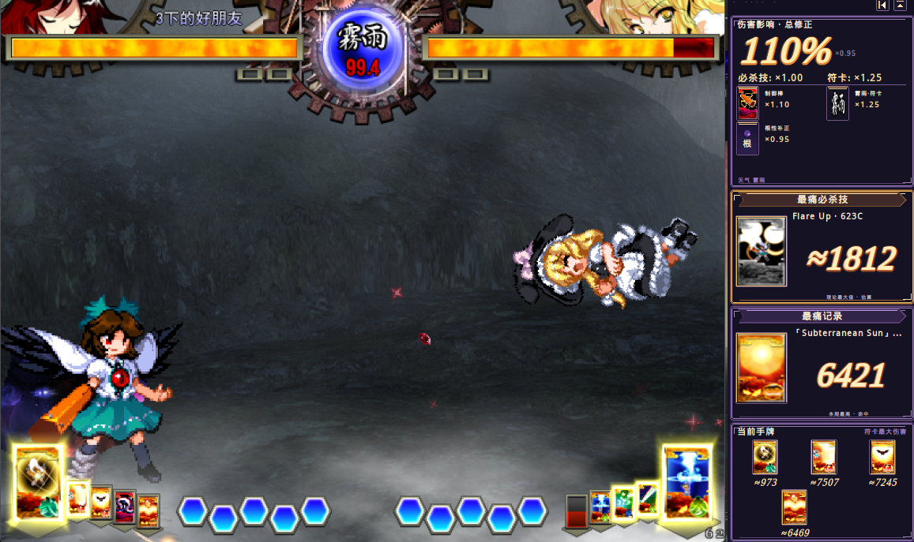

# SokuMaxDamageHUD · 什么最痛

[简体中文](README.md) · **English** · [日本語](README.ja.md)

A damage reference HUD for **Touhou Hisoutensoku v1.10a**. A companion panel below or to either side of the game shows estimated move damage, active modifiers and the best recorded hit. Chinese, Japanese and English interfaces are available.

**Uses hooks to observe combat without changing battle values.** Loaded by SokuModLoader, the mod uses game-function hooks and vtable callbacks to collect runtime state and events for estimates, damage attribution and display. These hooks modify function jumps or callbacks inside the game process; they do not change actual damage, character stats or other battle state, modify network packets, interfere with the random number generator (RNG), or send gameplay inputs. Image extraction leaves the original game archives untouched; generated images and UI preferences are stored in the mod’s own folder.

**Giuroll 0.6.18 compatibility:** damage records participate in its public rollback callbacks, so replayed predictions do not accumulate twice. No Giuroll or launcher configuration changes are required.


*Full interface*


*HUD detail*


### Display layouts

The HUD supports **bottom horizontal**, **left portrait**, and **right portrait** docking in both windowed mode and **WindowResizer borderless fullscreen** (exclusive fullscreen is not supported). Use the panel's **direction buttons**, or **drag the HUD with the mouse** toward the bottom, left, or right edge of the game: a translucent preview shows where it will snap on release. No keyboard shortcut is required.



*In-game screenshot of the right sidebar; switch among bottom, left and right with buttons or drag-and-drop.*

## Install

Requires Hisoutensoku v1.10a with a working mod loader: SokuLauncher, SokuModLoader or SWRSToys.

1. Close the game. Download `SokuMaxDamageHUD-vVERSION-win32.zip` from [Releases](https://github.com/HawkingChen/SokuMaxDamageHUD/releases/latest), rather than Source code.
2. Extract the **`SokuMaxDamageHUD` folder** from the ZIP into the game's **`modules`** folder.
3. Enable **SokuMaxDamageHUD** on SokuLauncher's mods page and start the game.

The DLL should be at `GAME/modules/SokuMaxDamageHUD/SokuMaxDamageHUD.dll`.

<details>
<summary>Using SWRSToys directly</summary>

Add this line under `[Module]` in the `SWRSToys.ini` used by your installation:

```ini
SokuMaxDamageHUD=modules/SokuMaxDamageHUD/SokuMaxDamageHUD.dll
```

Enable the DLL only once; avoid duplicate entries under different names.

</details>

**No separate artwork download is needed.** On the first launch, the mod extracts card and weather images from your local `th123a.dat` / `th123b.dat` / `th123c.dat` into its `icons` folder. It leaves the archives and existing images untouched, works offline, and needs no Python or extra script. If artwork is missing, check your game archives, write access to the mod folder. Text placeholders remain available if extraction fails.

To update, back up the old folder, close the game, and replace the files with the new version. To uninstall, disable the mod in your launcher, then delete its `SokuMaxDamageHUD` folder.

## Use

- **Damage modifiers**: the large percentage is the common attack/defense modifier. Guts appears in grey; special and spell multipliers are separate. Stacked cards show effects and their counts.
- **Strongest special**: the highest estimated damage among known available special moves. Equal-damage B/C variants may share a caption such as `623B/C`.
- **Best hit**: the highest recorded single-move damage this match, including normals and spells.
- **Current hand**: estimated spell damage in hand order.
- The **CN / JP / EN** button cycles languages. Two direction buttons switch to the other dock positions; the bold up button collapses the panel. A translucent **＋** inside the game’s bottom-right corner expands it. Preferences are saved automatically.

**Window layouts:** the panel restores its last dock and collapsed or hidden state at launch. Use buttons or drag to choose bottom/left/right; no keyboard shortcuts. Portrait matches the game height without distorting artwork or text, with damage modifiers first and emphasized percentages/type multipliers.

Initial placement and explicit bottom selection shrink the game only for substantial bottom overflow. Windowed mode keeps the top-left fixed; fullscreen centers the game and HUD together. The client remains 4:3. The largest fitting size leaves about 8px clearance. Small overflow (about 24–48px) is tolerated to avoid sensitive side switching. Sidebars always attach outside the game and never move inside it.

In windowed mode, a bottom panel that substantially overflows switches to the roomier side. Sidebars switch only to a materially roomier side, preventing loops. A translucent static drag preview follows the pointer and snaps only near an edge; releasing selects the nearest dock. Damage recording continues.

Supports ordinary windows and **WindowResizer borderless fullscreen**, not exclusive fullscreen. Entering fullscreen with the bottom panel automatically refits it. Selecting a side from bottom in fullscreen restores the window size saved on entering fullscreen. `[HUD] AutoFit=0` in `SokuMaxDamageHUD.ini` disables initial fitting; explicit bottom selection still permits fitting. `SideWidth` sets portrait width. The HUD hides outside battles or when the game loses focus.

## Limitations

- `≈` means an estimate, not a full simulation. Move level, hit count, positioning and some special states affect the result. A first-hit bonus is not applied to an entire multi-hit move estimate.
- Records track projectile casting sources and sum hits from the same cast. Overlapping sources and unusual mechanics may still be unidentified. Some move data is incomplete.
- Online host/client, spectating, replays and mod combinations have not all been validated in-game. This mod does not modify game damage or network packets.
- Automatic image extraction requires a new build containing this feature; older release ZIPs do not gain it automatically.

## Feedback and credits

Report problems in [Issues](https://github.com/HawkingChen/SokuMaxDamageHUD/issues), including the mod version, game mode, characters, move and a screenshot or reproduction steps.

Damage references include [Cleista Framedata](https://soku.cleista.cc/framedata). Japanese skill and spell names have been checked against the original v1.10a card tables. Artwork is generated from the player's own game and is not distributed in this repository or release ZIP; game assets belong to their respective rights holders.

[Building from source](docs/BUILD.md) · [MIT code license](LICENSE)
