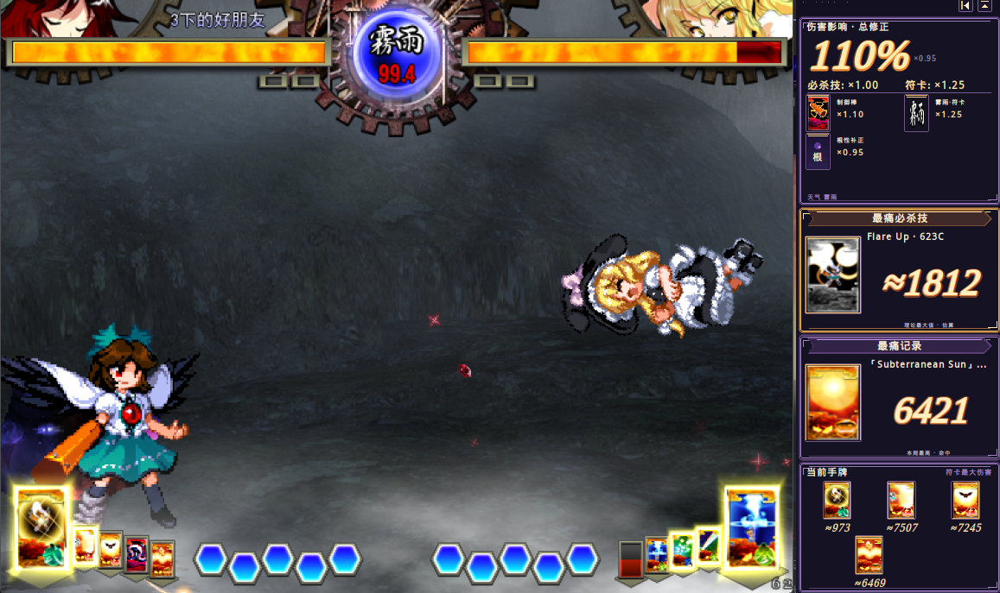

# SokuMaxDamageHUD · 什么最痛

**简体中文** · [English](README.en.md) · [日本語](README.ja.md)

《东方非想天则》**v1.10a** 的伤害参考面板 MOD。可以在游戏窗口下方或左右侧栏显示招式估算、伤害修正和本局记录，支持中文、日文、英文。

通过 Hook 读取战斗状态，不改写战斗数值。本 MOD 由 SokuModLoader 加载，通过游戏函数和虚表回调采集运行时状态与事件，用于估算、伤害归因和显示。不会改写实际伤害、角色属性等战斗状态或网络封包，不干预随机数（RNG），也不向游戏发送操作。自动提图只读取原始资源文件，生成的图片和界面设置保存在 MOD 自己的目录中。

**Giuroll 0.6.18 兼容：** 通过其官方回滚回调同步恢复 HUD 的伤害记录，避免预测重演重复累计；无需修改 Giuroll 或启动器配置。


*完整界面*


*HUD 细节*


### 支持的显示布局

HUD 支持 **下方横向、左侧竖向、右侧竖向** 三种停靠模式，适用于普通窗口和 **WindowResizer 无边框全屏**（非独占全屏）。可以点击 HUD 顶部的**方向按钮**切换，也可以用**鼠标拖动 HUD**，靠近游戏窗口的下方、左侧或右侧时吸附，松开即可切换；拖动时有半透明位置预览。无需快捷键。



*右侧竖向侧栏实机截图；下方、左侧和右侧布局可通过按钮或鼠标拖动自由切换。*

## 安装

需要已能加载 MOD 的非想天则 v1.10a（SokuLauncher / SokuModLoader / SWRSToys）。

1. 退出游戏，从 [Releases](https://github.com/HawkingChen/SokuMaxDamageHUD/releases/latest) 下载 `SokuMaxDamageHUD-v版本号-win32.zip`，不要下载 Source code。
2. 将 ZIP 中的 **`SokuMaxDamageHUD` 文件夹**解压到游戏的 **`modules`** 目录。
3. 在 **SokuLauncher 的模组页面启用 SokuMaxDamageHUD**，然后启动游戏。

安装后的文件位置应为 `游戏目录/modules/SokuMaxDamageHUD/SokuMaxDamageHUD.dll`。

<details>
<summary>直接使用 SWRSToys</summary>

在实际使用的 `SWRSToys.ini` 的 `[Module]` 段加入：

```ini
SokuMaxDamageHUD=modules/SokuMaxDamageHUD/SokuMaxDamageHUD.dll
```

只启用一次，避免用不同条目重复加载同一个 DLL。

</details>

**卡图不需要另行下载。** 首次启动会自动从本机游戏的 `th123a.dat` / `th123b.dat` / `th123c.dat` 提取卡牌与天气图片到 MOD 的 `icons` 目录；不修改游戏资源、不联网，也不覆盖已有图片。无需 Python 或额外脚本。若没有图标，检查游戏资源是否完整、MOD 目录是否可写；提取失败时仍会显示文字占位图。

更新前建议备份原文件夹，退出游戏后覆盖新版文件。卸载时在启动器中禁用，再删除 `SokuMaxDamageHUD` 文件夹即可。

## 使用

- **伤害影响 · 总修正**：大号百分比显示共通攻防修正；灰色数值显示根性补正，必杀技和符卡 的专属倍率单列。下方卡堆展示影响因素及叠加数量。
- **最痛必杀技**：只从当前真正启用的技能变体中选择，按当前有效等级寻找已验证的逐段资料；未验证的招式继续使用来源明确的静态参考值。B / C 版等伤害时可合并显示为 `623B/C`。黄沙只对有来源的「与CH」首 Hit 加成，不把所有技能或后续 Hit 整体放大。
- **最痛记录**：按同一次施放归集实际伤害，包含普通技、符卡及持续产生的弹幕。已跟踪的父弹幕消失后，其明确关联的后续子弹幕仍可归属该次施放，受身后继续命中也累计在同一施放。**延迟弹幕与另一招同帧命中时**，若无法可靠拆分伤害，混合总值不会作为某一招的新最高纪录；例如萃香 5C＋J6A 不应显示为「J6A 3057」。
- **当前手牌**：按手牌顺序展示符卡 的估算伤害。
- 按钮组中的 **CN / JP / EN** 按钮循环切换语言；两个方向按钮切换到另外两种停靠位置；粗箭头按钮收起。游戏画面右下角的半透明 **＋** 可展开。设置会自动保存。

**窗口布局**：启动时恢复上一次的停靠位置和收起／隐藏状态。通过按钮或拖动切换下、左、右，无快捷键。竖版与游戏窗口等高，图文保持比例；总修正在最上方，百分比和必杀技/符卡倍率突出显示。

首次布局及主动选下方时，仅在 HUD 明显超出桌面下沿时缩小游戏，窗口模式固定游戏左上角，全屏下将游戏与 HUD 整体居中，保持客户区 4:3，计算刚好放下游戏与 HUD 的最大尺寸并留约 8px 余裕。允许约 24–48px 的轻微越界，避免轻移窗口就换边。左右 HUD 始终贴在游戏外侧；空间不足不覆盖游戏画面。

窗口模式下，下方明显放不下时自动选择较宽的一侧；侧栏不足仅在另一侧明显更宽时换边，防止循环。拖动显示静态半透明替身，靠近边缘才吸附，松开固定到最近停靠位置，伤害记录不中断。

支持普通窗口与 **WindowResizer 无边框全屏**，独占全屏不支持。下方布局进入全屏时会自动重新腾出 HUD 空间；全屏下从下方主动切到左右会恢复该次进入全屏时的原窗口尺寸。`SokuMaxDamageHUD.ini` 中 `[HUD] AutoFit=0` 禁止首次自动调整，主动下方布局仍允许调整；`SideWidth` 设置侧栏宽度。失焦或退出对战时隐藏 HUD。

## 已知限制

- `≈` 表示参考估算，并非精确模拟。等级可用性已检查已知命令与美铃 Lv2 空中降华蹴；其余角色的等级锁定派生仍需逐招核实。`MoveProfiles.txt` 暂无逐 Hit 完整验证数据，存在可信资料时优先使用逐段计算；没有时保留参考估算。黄沙首击候选保存在 `OpeningCounter.txt`，只覆盖已有来源的少量招式，未列入的不擅自加成。
- 实际记录按弹幕来源和同次释放累计；持续性符卡的生成链及短时间消失的父弹幕可追踪，但同一帧多个来源、没有父子关联的新弹幕、天气掉血等仍可能无法识别招式。
- 联网主客机、观战、回放以及不同 MOD 组合尚未完成全面实机验证。该 MOD 不修改游戏伤害或网络封包。
- 本次新增的自动提图需要使用包含该功能的新构建；旧版发布包不会自动获得此功能。

## 反馈与资料

遇到问题请在 [Issues](https://github.com/HawkingChen/SokuMaxDamageHUD/issues) 提供 MOD 版本、游戏模式、角色、招式及截图或复现步骤。

伤害参考数据来自 [Cleista Framedata](https://soku.cleista.cc/framedata) 等公开资料；日语技能及符卡名已与原版 v1.10a 卡名表核对。卡面由玩家本地游戏生成，不随仓库和 ZIP 分发；游戏资源权利属于原权利人。

[开发与构建](docs/BUILD.md) · [MIT 代码许可](LICENSE)
